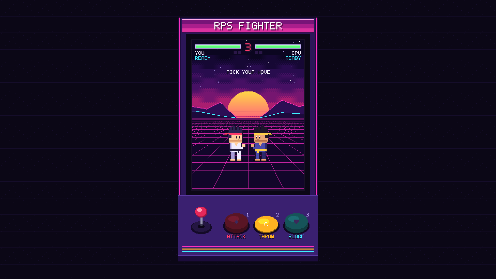
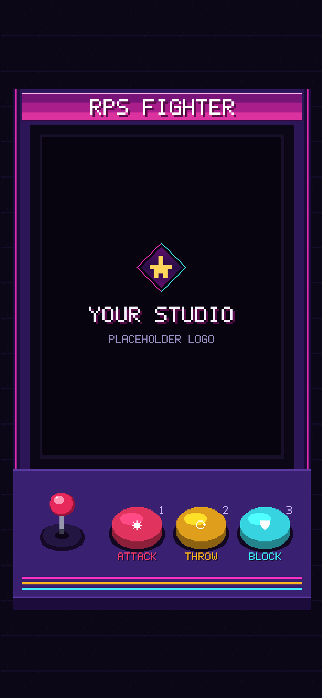
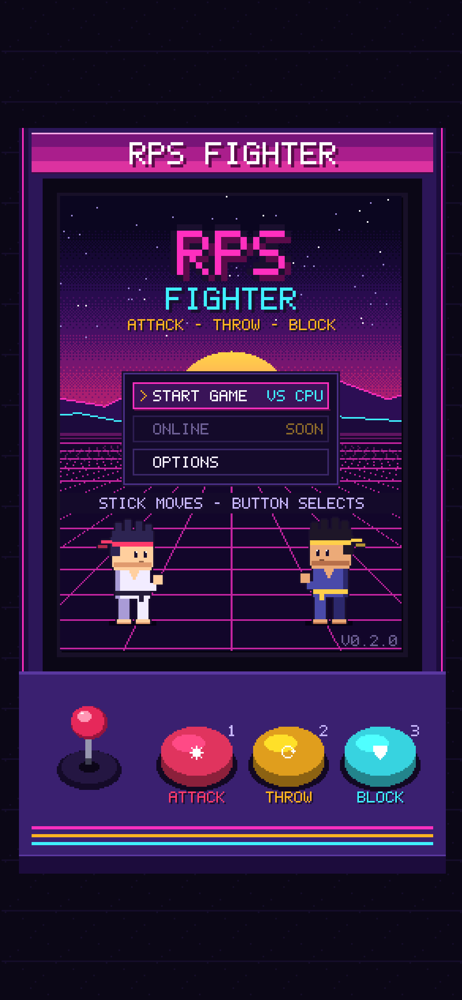
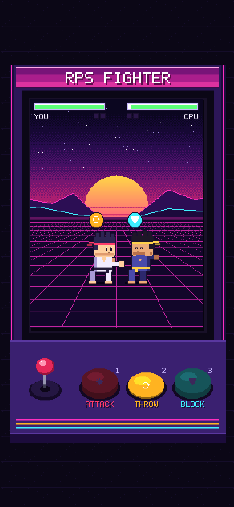
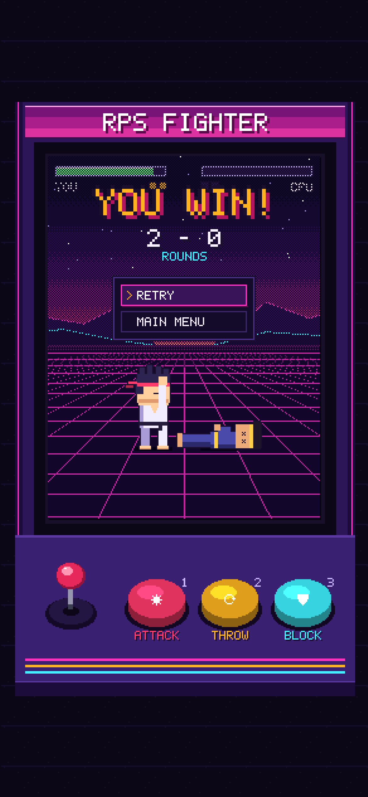
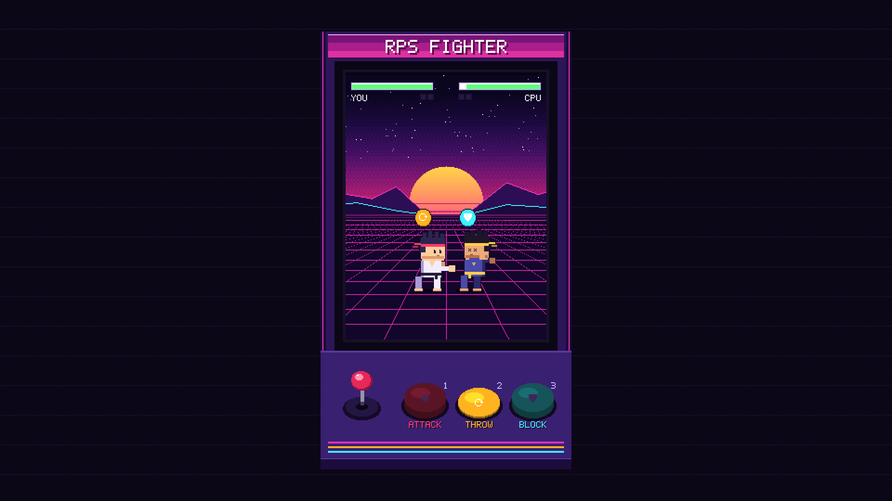
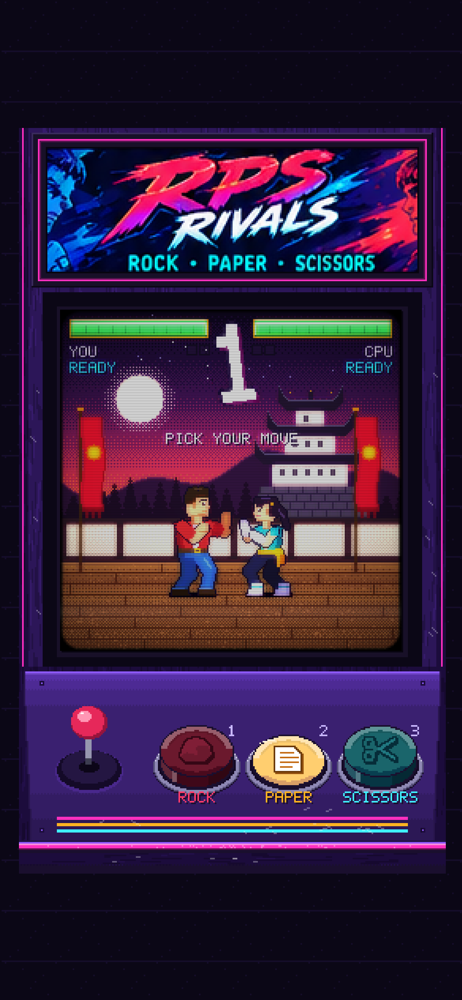

# Rock Paper Scissors Fighter

A pixel-art fighting game built on rock paper scissors, played in the browser.

**[▶ Play it in your browser](https://robinneefs.github.io/RPS-Fighter/)** on desktop or on a phone held upright, no install needed.

Two fighters face off inside an arcade cabinet. Each exchange, both players secretly pick **Attack**, **Throw** or **Block** before a 5 second countdown runs out. The picks are revealed together, the fighters act out their moves, and the loser of the exchange takes damage. Best of three rounds.



> **Status: first playable (v0.2.0).** Logo intro, home menu with Options, a full best-of-three match against a random CPU and the Retry / Main menu screen work, with placeholder art. Final fighter art, effects and sound come next.

| Logo intro | Home | Fight | Result |
|---|---|---|---|
|  |  |  |  |

Screenshots of the current build on a phone. Recapture them with `node sources/screenshots/capture.mjs`.

## Play it locally

Needs Node 22.

```sh
npm install
npm run dev        # opens the game at http://localhost:5173
```

Controls: keys **1 / 2 / 3** (or tap the cabinet buttons) pick Attack / Throw / Block. In menus the arrow keys (or dragging the joystick) move the cursor and any cabinet button, Enter or Space selects. Esc goes back.

| Command | What it does |
|---|---|
| `npm test` | Rules, referee and session tests (Vitest) |
| `npm run test:e2e` | Browser smoke test (Playwright) |
| `npm run lint` | ESLint, including the layer import rules |
| `npm run typecheck` | TypeScript, strict |
| `npm run build` | Production build into `apps/game/dist` |

## How it plays

| Winning move    | Beats  | Damage to loser |
|-----------------|--------|-----------------|
| Throw           | Block  | 20              |
| Attack          | Throw  | 15              |
| Block (counter) | Attack | 10              |

- Ties deal no damage, and only the loser of an exchange gets hurt.
- Each fighter has 100 health per round. Health resets every round.
- Best of three rounds wins the match.
- No pick before the timer runs out? You get a random move.

### The mind game

Because the damage is uneven, this is not classic rock paper scissors. Throw is the tempting big hit, but Attack punishes it. The balanced mix works out to roughly **Attack 44%, Block 33%, Throw 22%**: the biggest hit is the one you should pick least. At low health the stakes shift again, since a 10 damage block counter may not finish the round while a 15 or 20 hit will.

## Look and feel

- **Arcade cabinet layout.** The whole game is drawn as an upright arcade machine: the fight on the monitor, three physical buttons (Attack, Throw, Block) on the control panel, and a joystick just for fun. The vertical layout works the same in a desktop browser and on a phone held upright.
- **Pixel perfect.** One pixel size everywhere, whole-number scaling only, no blur or sub-pixel drift, pixel fonts and a shared palette.
- **Cute fighters, neon '80s arcade.** Short, wide chibi martial artists (64 px tall) in a synthwave arcade setting. The overall style is still being refined.
- **Game feel matters.** Punchy screen shake, hit flashes, sparks, hit-pause, lively animations and sound for every action.

| Browser | Phone |
|---|---|
|  |  |

## Technology

| Part | Choice |
|---|---|
| Engine | Phaser 3 |
| Language | TypeScript |
| Build | Vite |
| Tests | Vitest |
| Online play (later) | Node + Colyseus, server-authoritative |
| Android (later) | Capacitor |

The game rules live in a plain TypeScript module with no engine, timers or networking, so the same rules can run on a server for online play. See the [architecture document](docs/architecture/ARCHITECTURE.md) for the full plan.

## Roadmap

1. Rules core with tests
2. Playable prototype with placeholder fighters
3. Art and juice: sprites, effects, sound and music
4. Polish and release on the web, including a dedicated game-feel pass
5. Online play with room codes
6. Android app

## Repository layout

| Path | What's in it |
|---|---|
| [`packages/core/`](packages/core/) | `@rps/core`: the rules and the referee, plain TypeScript with zero dependencies |
| [`apps/game/`](apps/game/) | The Phaser game: scenes, views, session, input, pixel scaler, tuning |
| [`tools/`](tools/) | Small scripts (the placeholder logo) |
| [`PROJECT_CONTEXT.md`](PROJECT_CONTEXT.md) | Full project context: rules, decisions, open questions and the decision log |
| [`docs/idea/`](docs/idea/) | The original idea brief |
| [`docs/design/interactive-gdd.html`](docs/design/interactive-gdd.html) | Interactive design document with a playable sketch (open in a browser) |
| [`docs/architecture/ARCHITECTURE.md`](docs/architecture/ARCHITECTURE.md) | How the code is structured: layers, packages, online play, pixel-perfect rendering, tuning |
| [`docs/screenshots/`](docs/screenshots/) | Screenshots of the current build (browser and phone) |
| [`docs/mockups/cabinet/`](docs/mockups/cabinet/) | Arcade cabinet mock-ups drawn before the build (browser and phone) |
| [`docs/mockups/landscape-superseded/`](docs/mockups/landscape-superseded/) | Earlier landscape mock-ups, replaced by the cabinet layout |
| [`docs/art-direction/`](docs/art-direction/) | Art direction samples: sprite sizes, character styles, body shapes |
| [`sources/`](sources/) | The HTML/JS that draws the mock-ups, art samples and architecture diagrams, plus Playwright scripts to render them and to capture game screenshots |

## License

[MIT](LICENSE)
