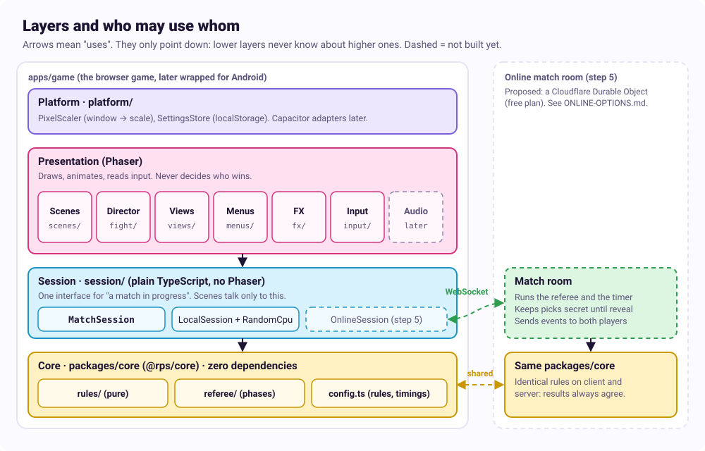
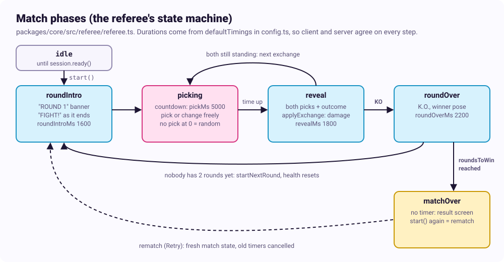
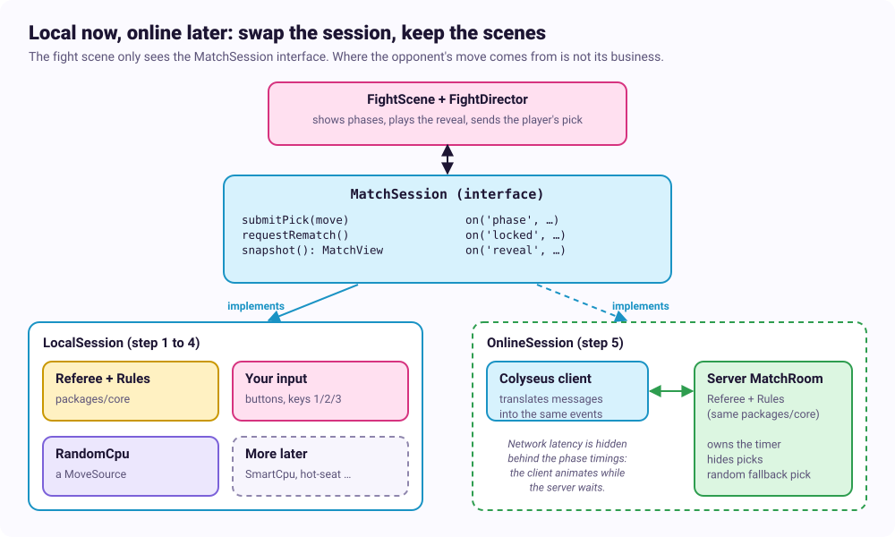
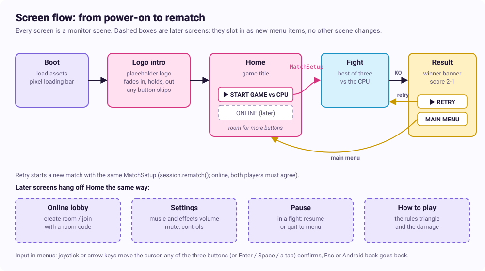
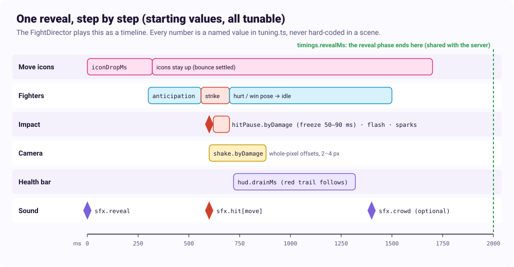
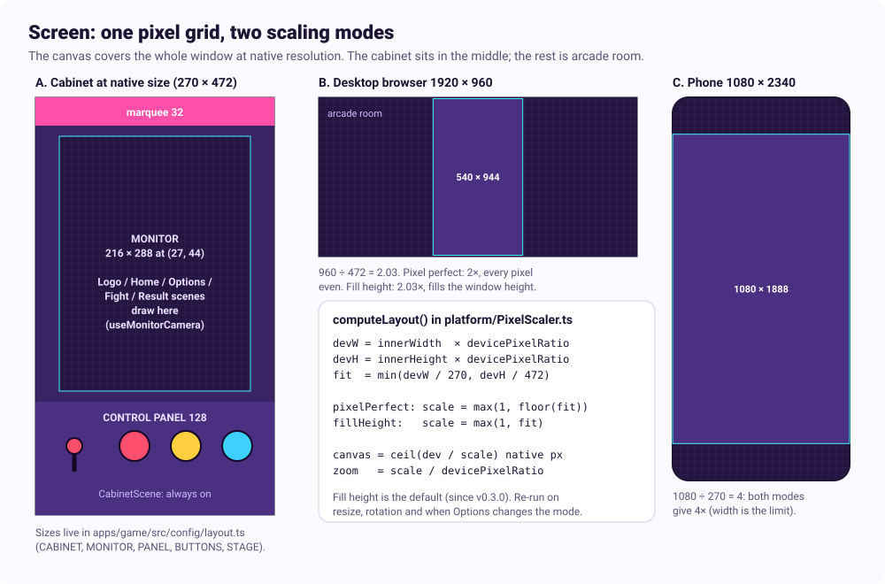
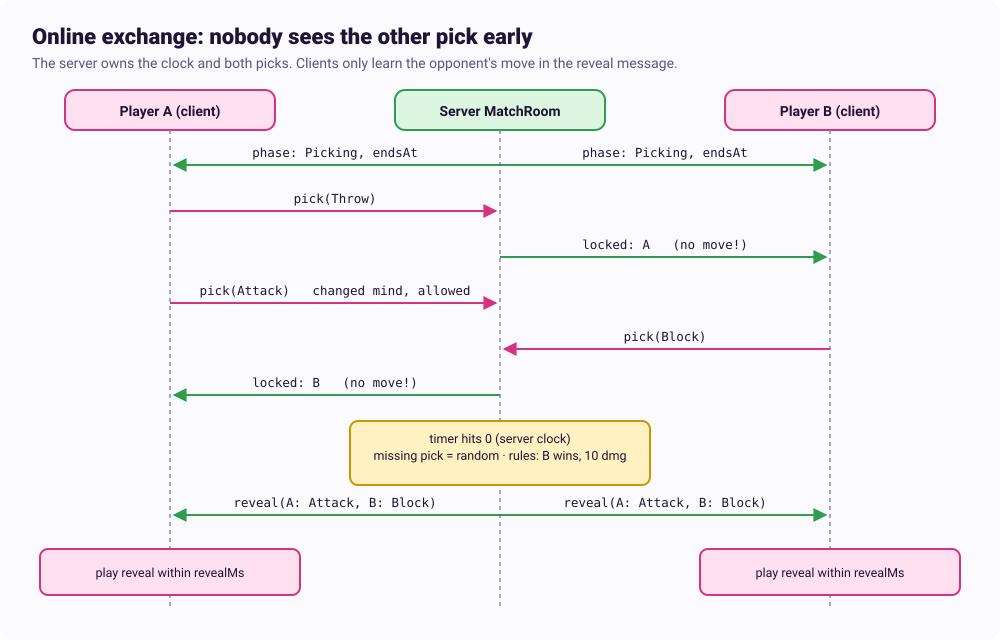

# Architecture

_Status: in use, 2026-10-10. Steps 1 and 2 of the build order are built (`packages/core`, `apps/game`); the code follows this document. Change it when a decision changes._

How the RPS Rivals code is organised so that it stays readable as it grows: from a local game against a random CPU, to online play, to an Android app. It builds on the decisions in [`PROJECT_CONTEXT.md`](../../PROJECT_CONTEXT.md) (Phaser 3, TypeScript, Vite, Vitest, Colyseus later, Capacitor later, arcade cabinet layout, pixel perfect, polish as a core goal).

## Contents

1. [Goals](#1-goals)
2. [The big picture: four layers](#2-the-big-picture-four-layers)
3. [Repository layout](#3-repository-layout)
4. [Core: rules and referee](#4-core-rules-and-referee)
5. [Session: local now, online later](#5-session-local-now-online-later)
6. [Presentation: scenes, director, views](#6-presentation-scenes-director-views)
7. [Screen and pixel-perfect rendering](#7-screen-and-pixel-perfect-rendering)
8. [Tuning: every feel value in one place](#8-tuning-every-feel-value-in-one-place)
9. [Input, audio, assets, settings](#9-input-audio-assets-settings)
10. [Online play](#10-online-play)
11. [Android](#11-android)
12. [Keeping the code clean](#12-keeping-the-code-clean)
13. [Testing](#13-testing)
14. [How the design grows](#14-how-the-design-grows)
15. [Build order](#15-build-order)
16. [Choices to confirm](#16-choices-to-confirm)

---

## 1. Goals

| Goal | What it means for the code |
|---|---|
| **Readable** | Small files with one job each. A newcomer can find "where does damage happen?" in seconds. |
| **Expandable** | New moves, CPUs, fighters, modes and online play slot in without rewriting what exists. |
| **Online ready** | The rules run identically on a server. The client never needs to know the opponent's move early. |
| **Testable** | Everything that decides something is plain TypeScript, tested without a browser. |
| **Pixel perfect** | One pixel grid, whole-number scaling, whole-pixel positions, enforced in one place. |
| **Polished** | All timings and juice values are named and tunable, never buried in scene code. |

The one rule behind all of it: **the code that decides is separate from the code that shows.**

## 2. The big picture: four layers



| Layer | Job | Knows about |
|---|---|---|
| **Core** (`packages/core`) | The rules (who wins, damage, health, rounds) and the referee (match phases and their timing). | Nothing. Zero dependencies: no Phaser, no browser, no network. |
| **Session** (`apps/game/src/session`) | "A match in progress" as seen by one player. Takes the player's pick, reports what happened. | Core. |
| **Presentation** (`apps/game/src/scenes`, `views`, `fx`, ...) | Draws, animates, plays sound, reads input. | Session (through its interface), Phaser. |
| **Platform** (`apps/game/src/platform`) | The browser page now, the Capacitor shell later. Screen scaling, storage, haptics. | The device. Exposed to the game through small adapters. |

Dependencies only point **down**. Core never imports anything from the game, the session never imports Phaser, and scenes never decide a result. These rules are checked by the linter (see [section 12](#12-keeping-the-code-clean)), so they can't erode quietly.

## 3. Repository layout

An npm workspaces monorepo. The core is its own package from day one, so the future server can depend on it and the "no Phaser in the rules" rule is enforced physically: `packages/core` simply has no Phaser dependency to import.

```
rock-paper-scissors/
├── packages/
│   └── core/                    @rps/core: rules + referee, zero dependencies
│       ├── src/
│       │   ├── rules/           pure functions: resolve an exchange, apply damage, rounds
│       │   ├── referee/         match phase machine (uses an injected clock and RNG)
│       │   ├── config.ts        RulesConfig: damage table, health, rounds, phase timings
│       │   └── index.ts         the public API, nothing else is imported from outside
│       └── test/
├── apps/
│   ├── game/                    the Phaser client (Vite)
│   │   ├── index.html
│   │   ├── public/assets/       sprite sheets, fonts, audio (exported, not source files)
│   │   └── src/
│   │       ├── main.ts          boots Phaser, picks the session, starts the scenes
│   │       ├── config/          tuning.ts, palette.ts, phaser config
│   │       ├── platform/        pixel scaler, storage, haptics, device info
│   │       ├── session/         MatchSession interface, LocalSession, move sources (CPU)
│   │       ├── input/           maps keys, taps and cabinet buttons to game actions
│   │       ├── scenes/          Boot, Cabinet, Logo, Home, Fight, Result (thin) + flow.ts
│   │       ├── menus/           menu definitions as data (homeMenu.ts, resultMenu.ts)
│   │       ├── fight/           FightDirector: turns session events into choreography
│   │       ├── views/           FighterView, HudView, MoveIconView, BannerView, ButtonsView, JoystickView, MenuView, LogoView
│   │       ├── fx/              shake, hit-pause, flash, sparks, dust (the "juice" kit)
│   │       ├── audio/           AudioService, sound keys, music/sfx volumes
│   │       ├── assets/          typed asset keys and the load manifest
│   │       └── util/            pixel snapping, typed event emitter, small helpers
│   └── server/                  (step 5) Colyseus server using @rps/core
├── tools/                       scripts: sprite sheet packing, palette checks
├── docs/  sources/              design docs, mock-ups, art direction (as today)
└── package.json                 workspaces, shared lint/format/test scripts
```

Starting folders only; a folder is added when there is something to put in it, not before.

## 4. Core: rules and referee

The core has two parts with different jobs.

### 4a. Rules: pure functions

Data in, data out. No time, no randomness, no side effects. This is where the damage table and "only the loser takes damage" live, and nowhere else.

```ts
// packages/core/src/rules/types.ts
export type Move = 'attack' | 'throw' | 'block';
export type Side = 'p1' | 'p2';

export interface RulesConfig {
  beats: Record<Move, Move>;          // attack→throw, throw→block, block→attack
  damage: Record<Move, number>;       // damage dealt when this move wins: throw 20, attack 15, block 10
  startHealth: number;                // 100
  roundsToWin: number;                // 2 (best of three)
}

export interface MatchState {
  round: number;
  health: Record<Side, number>;
  roundsWon: Record<Side, number>;
  winner: Side | null;                // set when the match is over
}

export type ExchangeOutcome =
  | { kind: 'tie'; picks: Record<Side, Move> }
  | { kind: 'win'; picks: Record<Side, Move>; winner: Side; damage: number };
```

```ts
// packages/core/src/rules/exchange.ts
export function resolveExchange(picks: Record<Side, Move>, cfg: RulesConfig): ExchangeOutcome { … }

// Returns the new state plus a list of what happened, for the presentation to play back.
export function applyExchange(state: MatchState, picks: Record<Side, Move>, cfg: RulesConfig):
  { state: MatchState; outcome: ExchangeOutcome; events: RuleEvent[] } { … }
// RuleEvent = 'damage' | 'ko' | 'roundWon' | 'matchWon' (with details)
```

The state is never changed in place; a new state comes back. That makes every result easy to test, log and replay, and it is exactly what the server will need.

Moves are data (`beats` and `damage` tables), not `if` chains, so a balance change or a fourth move is a config edit, not a code rewrite.

### 4b. Referee: the match phases

The referee runs one match: it moves through the phases, collects picks, fills in a random pick when time runs out, and calls the rules. It needs a clock and randomness, but **both are passed in**, so the referee itself stays engine-free and testable with a fake clock and a seeded RNG.



```ts
// packages/core/src/referee/referee.ts
export interface Clock { now(): number; schedule(ms: number, fn: () => void): Cancel; }
export interface Rng { next(): number; }                       // 0..1, seedable

export class Referee {
  constructor(cfg: RulesConfig, timings: PhaseTimings, clock: Clock, rng: Rng) {}
  start(): void;
  submitPick(side: Side, move: Move): void;   // allowed (and changeable) only during Picking
  on<E extends keyof RefereeEvents>(e: E, fn: (p: RefereeEvents[E]) => void): Unsubscribe;
}
// RefereeEvents: phase { phase, endsAt }, locked { side }, reveal { picks, outcome, state }, …
```

The same `Referee` class runs inside the local game now and inside the Colyseus room later, with a different `Clock` adapter. That is the main reason online play won't need a rewrite.

**Phase timings are rules, not feel.** `pickMs`, `revealMs`, `roundIntroMs` and `roundOverMs` live in the core config because the server has to agree with them. The client plays its animations *inside* those windows (see [section 6](#6-presentation-scenes-director-views)).

## 5. Session: local now, online later

The fight scene must not care whether the opponent is a CPU on the same device or a person across the world. So it talks to one interface, `MatchSession`, and never to the referee directly.



```ts
// apps/game/src/session/MatchSession.ts
export interface MatchSession {
  readonly me: Side;
  ready(): void;                         // the scene is listening: local starts the match, online tells the server
  submitPick(move: Move): void;
  requestRematch(): void;
  snapshot(): MatchView;                 // current phase, health, rounds, timer end
  on<E extends keyof SessionEvents>(e: E, fn: (p: SessionEvents[E]) => void): Unsubscribe;
  dispose(): void;
}
```

| Implementation | When | How it works |
|---|---|---|
| `LocalSession` | Steps 1 to 4 | Owns a `Referee` with a browser clock. Your picks go straight in; the opponent's come from a **move source**. |
| `OnlineSession` | Step 5 | A Colyseus client. Sends your pick to the server and turns server messages into the same `SessionEvents`. |

A **move source** is anything that can produce a pick for one side:

```ts
export interface MoveSource {
  onPickingStarted(ctx: PickContext): void;   // ctx: health, rounds, history, deadline, rng
  // calls back into the session with a move when it decides
}
```

`RandomCpu` is the first one (uniform random, as decided). An equilibrium CPU (44/33/22), a pattern-reading CPU or local hot-seat play are each one new file, with no other code touched.

## 6. Presentation: scenes, director, views

Phaser code is split into three kinds of pieces, each with one job:

| Piece | Job | Example |
|---|---|---|
| **Scene** | Wiring only: creates views, connects the session and input, starts and stops. Short. | `FightScene` |
| **Director** | Listens to session events and turns them into choreography over time, using tuning values. | `FightDirector` plays the reveal timeline below |
| **View** | A dumb visual piece with a small API. Knows nothing about rules or sessions. | `FighterView.play('throw')`, `HudView.setHealth('p2', 70)` |

The **juice kit** (`fx/`) is a set of small reusable effects (`shake`, `hitPause`, `flash`, `sparks`, `dust`) that views and the director call. Each reads its numbers from `tuning.ts`.

### The scenes

| Scene | Runs | Draws |
|---|---|---|
| `BootScene` | Once | Loads assets, shows a pixel loading bar |
| `CabinetScene` | Always, underneath everything | Arcade room backdrop, cabinet body, marquee, control panel, the three buttons and the joystick |
| `LogoScene` | Once per launch, on the monitor | Studio logo (Chain Shift): fades in, holds, fades out. Any button or tap skips it |
| `HomeScene` | On the monitor | Game title, idle fighters, the home menu (Start game vs CPU; Online greyed out until step 5; Options) |
| `OptionsScene` | On the monitor, from Home | Settings menu; for now one setting, Scaling (Pixel perfect or Fill height), applied at once and saved |
| `FightScene` | On the monitor | Fighters, HUD, move icons, banners, effects |
| `ResultScene` | On the monitor, over the last fight frame | Winner banner, score, menu: Retry or Main menu |

Monitor scenes use a **camera viewport** placed over the cabinet's screen, so they always draw in their own 216 × 288 space and don't care where the cabinet sits in the window. Screen shake moves only the monitor camera; the cabinet stays put (a small cabinet rattle on KO can be its own effect).

### Screen flow and menus



The game always starts the same way: Boot, then the logo intro, then the home screen. From there **Start game** begins a match against the CPU, and when the match ends the result screen offers **Retry** (a new match with the same setup) or **Main menu**. This is deliberately small, but it is the infrastructure later menus plug into.

- **Logo intro.** `LogoScene` shows one image, `assets/logo.png` (the Chain Shift logo since v0.4.0, built from the master in `docs/brand/` by `python3 tools/make-logo.py`). It fades in, holds and fades out using `tuning.intro` values. To stay pixel perfect the fade steps through a few darkened palette levels instead of a smooth alpha blend. Any button, key or tap skips it.
- **Menus are data.** A menu is a list of items `{ id, label, tag?, enabled, onSelect }` in `menus/`. One reusable `MenuView` draws any list, moves the cursor, skips disabled items, blinks the cursor and plays the move and confirm sounds. The home menu today:

  ```ts
  // apps/game/src/menus/homeMenu.ts
  export const homeMenu = (flow: SceneFlow): MenuItem[] => [
    { id: 'cpu',    label: 'START GAME', tag: 'VS CPU', enabled: true,  onSelect: () => flow.toFight({ mode: 'cpu', cpu: 'random' }) },
    { id: 'online', label: 'ONLINE',     tag: 'SOON',   enabled: false },   // step 5: opens LobbyScene
    { id: 'options', label: 'OPTIONS',                      enabled: true,  onSelect: () => flow.toOptions() },
  ];
  ```

  Adding online play, settings or a how-to-play screen is a new item here plus its scene; no other scene changes. Options was added this way (2026-10-10): `menus/optionsMenu.ts` + `OptionsScene`. A setting's current value shows as the item's tag (`MenuView.setTag`); confirm, or left / right on the stick, flips it.
- **One place for transitions.** Scenes never start each other by key. A small `SceneFlow` (`scenes/flow.ts`) has `toHome()`, `toOptions()`, `toFight(setup)`, `toResult(outcome)` and plays the transition (a short pixel wipe, timed by `tuning.transitions`). 
- **`MatchSetup` describes a match.** `toFight(setup)` builds the session from the setup (`createSession(setup)` in `session/`): `{ mode: 'cpu', cpu: 'random' }` now, `{ mode: 'online', roomCode }` later. The setup travels to the result screen, so **Retry** is `session.requestRematch()`: the session answers with a `rematchAccepted` event (locally at once; online once both players agree), and the flow reopens the fight with the same session, which starts again on `ready()`.
- **Menu input.** The `InputRouter` adds menu actions: `nav:up` / `nav:down` (joystick, arrow keys), `confirm` (any of the three cabinet buttons, Enter, Space) and `back` (Esc, Android back). Menu items on the monitor can also be tapped or clicked. In menus the joystick finally does something; in a fight it stays decoration.
- **Music.** The menu loop plays on Home and Result; the fight loop in `FightScene`. `SceneFlow` asks `AudioService` to cross-fade on each transition.

### One reveal, as the director plays it



The director receives a single `reveal` event (both picks, the outcome, the new state) and plays it as a timeline. Every duration and strength is a named value in `tuning.ts`. The whole show must fit inside `timings.revealMs`, which the referee (and later the server) uses as the length of the reveal phase. A dev-mode check warns if the timeline runs longer than the window.

Views animate toward the state the session reports; they never compute it. If the health bar and the rules ever disagree, the rules win, by design.

## 7. Screen and pixel-perfect rendering

The pixel-perfect rules from the project context are enforced in one place, the **pixel scaler** in `platform/`, plus a few habits in the views.



1. **One native canvas, one pixel size.** The cabinet, monitor, HUD, backdrop and effects all draw into one Phaser canvas at native resolution. No HTML or CSS overlays for game visuals.
2. **Whole-number zoom.** The scaler picks the largest whole scale at which the cabinet fits the window, measured in *device* pixels (so it is crisp on high-DPI phones too), and sets Phaser's zoom to it. Re-run on resize and rotation. This is the default **Pixel perfect** scaling mode.
3. **The canvas fills the window; the leftover is arcade room.** The canvas is sized to the window divided by the scale, the cabinet is centred, and the space around it is backdrop drawn at the same pixel size. Nothing is ever stretched.
4. **Phaser settings:** `pixelArt: true`, `roundPixels: true`, `antialias: false`, `Scale.NONE` with the computed zoom.
5. **Whole pixels only.** Positions go through `snap()`; tweens and shake round to whole pixels; no `setScale` or `setRotation` on sprites (turns, squash and zoom are drawn as frames).
6. **Pixel text.** A bitmap pixel font at native size. No browser fonts on the canvas.

**Fill height (player option, 2026-10-10).** Whole-number scaling can leave the cabinet small (a 1280 × 800 window only fits 1×). Options → Scaling offers **Fill height**: the scaler uses the exact fit scale instead (`computeLayout(..., 'fillHeight')`: the cabinet fills the window height on a desktop, or its width on a narrow phone, never smaller than the pixel-perfect scale). This is a deliberate, player-chosen exception to rule 2:

- Sampling stays nearest-neighbour (`pixelArt`, `image-rendering: pixelated`), so nothing blurs, and everything inside the game still sits on one native grid (rules 1, 3 to 6 are unchanged).
- But at a fractional scale some rows and columns of native pixels come out one device pixel wider than their neighbours (at 1.7×, pixels are 1 or 2 device pixels wide). Thin lines and text can look slightly uneven, and a moving sprite can shimmer by a device pixel.
- Fill height is the default for a first visit (the user's call, 2026-10-10); players who want every pixel even pick Pixel perfect. The choice is kept in `SettingsStore` (`platform/settings.ts`), saved to localStorage and read before the game starts, so the first frame is already at the chosen scale. The pixel-perfect screenshot check (section 13) sets Pixel perfect first.

**Cabinet size (decided 2026-10-10): 270 × 472 native** (marquee 32, bezels 12, monitor 216 × 288, control panel 128). The earlier 270 × 502 frame only fit a typical 1080p browser window (about 950 px tall inside the browser) at 1×; at 472 it shows at 2× there, and at 4× on most phones. The cabinet mock-ups are redrawn at this size.

## 8. Tuning: every feel value in one place

Polish is a core goal, so every number that changes how the game *feels* lives in one typed file, `apps/game/src/config/tuning.ts`. Scenes, views and effects import from it; a magic number in a view is a review comment.

```ts
// apps/game/src/config/tuning.ts  (starting values, to tune)
export const tuning = {
  reveal:   { iconDropMs: 320, iconBouncePx: 4, strikeAtMs: 560, impactAtMs: 600 },
  hitPause: { byDamage: { 10: 50, 15: 70, 20: 90 } },          // ms the action freezes
  shake:    { byDamage: { 10: 2, 15: 3, 20: 4 }, durationMs: 280, falloff: 'linear' },
  flash:    { frames: 2, color: 'white' },
  hud:      { drainMs: 600, trailDelayMs: 120 },
  buttons:  { pressDepthPx: 2, releaseMs: 80 },
  joystick: { springBackMs: 90 },
  idle:     { breatheEveryMs: 900 },
  intro:    { fadeInMs: 500, holdMs: 1500, fadeOutMs: 500, fadeSteps: 4 },   // logo intro
  transitions: { wipeMs: 240 },
  menu:     { cursorBlinkMs: 400, repeatDelayMs: 300 },
  audio:    { sfxVolume: 0.8, musicVolume: 0.5 },
} as const;
```

There are two homes for numbers, on purpose:

| File | Holds | Why separate |
|---|---|---|
| `packages/core/src/config.ts` | Damage, health, rounds, phase timings (`pickMs`, `revealMs`, ...) | The server must use the same values. Changing them changes the game's rules. |
| `apps/game/src/config/tuning.ts` | Everything about look and feel | Client only. Changing them never changes who wins. |

**Dev tuning panel:** in development builds only, a small panel (Tweakpane) lists both files' values with sliders, edits them live while you play, and has a "copy changes" button that lists every changed value and its file, to paste the result back. Feel values apply live; rules and phase timings apply from the next match (each session gets its own copy), with a restart button. Edits are remembered in localStorage while tuning; the backquote key hides it. It is stripped from release builds (`main.ts` loads it behind `import.meta.env.DEV`, and a lint rule keeps the rest of the game from importing `dev/`). This makes the planned game-feel pass fast. User guide and setup details: [`docs/tuning/TUNING-PANEL.md`](../tuning/TUNING-PANEL.md).

## 9. Input, audio, assets, settings

**Input.** One `InputRouter` turns every source into game actions: keys 1/2/3, taps or clicks on the cabinet buttons, arrow keys and drag for the joystick, and later a gamepad. Scenes only hear actions like `pick:attack`, `stick:upLeft`, or in menus `nav:down`, `confirm` and `back`. Rebinding or adding a gamepad touches only `input/`.

**Audio.** An `AudioService` wraps Phaser sound with two buses (music, sfx), mute, and saved volumes. Sounds are referred to by typed keys (`Sfx.HitThrow`), and a key can map to several variations that are picked at random so hits don't repeat. Generated music (Tone.js) later plugs in as another music source.

**Assets.** Until the real art exists, `assets/placeholders/` draws every texture in code at boot (fighters, icons, cabinet, stage) under the real asset keys. Loading a real sprite sheet under the same key in `BootScene` makes its placeholder step aside; no view changes. Art comes out of Aseprite (or PixelLab) as sprite sheets with JSON frame data. A typed manifest (`assets/keys.ts`) lists every key, so a typo is a compile error instead of a missing sprite at runtime. One shared palette (`config/palette.ts`, plus a `tools/` script that checks exported images only use palette colours).

**Settings.** A `SettingsStore` in `platform/settings.ts` holds the player's settings, emits `change`, and saves them as JSON through a small key-value adapter (localStorage in the browser, Capacitor Preferences on Android later). Broken or missing storage (private mode, blocked site data) falls back to the defaults and never stops the game. Today it holds the scaling mode; volumes, mute and key bindings join it later. It is part of the `GameContext`.

**Version.** The build's version is set once, in `apps/game/package.json`; `vite.config.ts` injects it and `src/version.ts` exports it as `VERSION`, which the home screen shows small in the corner. Every published build bumps it and adds a `CHANGELOG.md` entry, and the Release workflow tags it `vX.Y.Z` with a GitHub release when it reaches main.

**Wiring.** No global singletons. `main.ts` builds the services once and passes them to scenes through one small `GameContext` object. Tests can hand in fakes.

## 10. Online play

Step 5 adds `apps/server`: a Node + Colyseus server whose `MatchRoom` wraps the same `Referee` from `@rps/core`, with a server clock. The server is the only place both picks exist before the reveal.



- **Hidden picks.** Picks are kept in server memory, not in the shared room state. The only thing broadcast during Picking is "this side has locked in". The opponent's move first leaves the server inside the `reveal` message.
- **Server clock.** The server decides when time is up and makes the random fallback pick. Clients show a countdown from the `endsAt` the server sends, so slow connections can't buy extra time.
- **Same events.** `OnlineSession` translates server messages into the same `SessionEvents` the local game uses. The fight scene, director and views don't change.
- **Latency.** The client animates the reveal while the server waits out `revealMs`, so small delays are invisible. Rooms are joined by a short room code.
- **Disconnects.** If a player drops, the room waits a short grace period, then auto-picks for them or ends the match. Exact behaviour is a step 5 decision.

## 11. Android

Step 6 wraps the built `apps/game` in Capacitor. Nothing in the game changes; device-specific things sit behind `platform/` adapters:

| Need | Browser | Android |
|---|---|---|
| Storage | localStorage | Capacitor Preferences |
| Haptics on hits and button presses | no-op (or Vibration API) | Capacitor Haptics |
| Back button | n/a | `back` action: Result goes to the main menu, Home exits the app; in a fight it opens the pause menu (once that exists) |
| Orientation | n/a | Locked to portrait |
| Safe areas (notch, gesture bar) | n/a | Scaler leaves room; the extra space is backdrop |

## 12. Keeping the code clean

**Import rules, checked by ESLint** (`import/no-restricted-paths`), so a wrong import fails the build:

| Folder | May import | Must not import |
|---|---|---|
| `packages/core` | nothing outside itself | Phaser, DOM, network, anything in `apps/` |
| `session/` | `@rps/core`, `util/` | Phaser, `scenes/`, `views/` |
| `views/`, `fx/` | Phaser, `config/`, `assets/`, `util/` | `session/`, `@rps/core` internals (types are fine) |
| `fight/` | session types, `views/`, `fx/`, `audio/`, `config/` | the `Referee` directly |
| `scenes/` | anything in the game | (keep them thin: wiring only) |
| `platform/` | the device APIs | game logic |

**Conventions.**
- TypeScript `strict`, no `any`. Prettier for formatting, ESLint for rules.
- One class or one concern per file; a file growing past about 200 lines is a hint to split it.
- Names say what things are: `FighterView`, `RandomCpu`, `resolveExchange`. No `Manager`/`Helper` grab bags.
- No magic numbers outside `config/` (and the core config).
- Events are typed (`on('reveal', …)` knows its payload).
- Comments explain *why*; the code says *what*.

**CI** (GitHub Actions, on every push and PR): lint, typecheck, tests, build. Later also the screenshot tests and a GitHub Pages deploy of `main`.

## 13. Testing

| Level | Tool | What | How much |
|---|---|---|---|
| Rules | Vitest | Every pairing, damage, ties, KO, rounds, match end | Exhaustive: it is the heart of the game |
| Referee | Vitest + fake clock + seeded RNG | Phase order, timer expiry, random fallback, changing a pick, rematch | All phase transitions |
| Session and CPUs | Vitest | `LocalSession` emits the right events; CPU mixes match their target odds | Main paths |
| Settings and scaler | Vitest | `computeLayout` in both scaling modes; settings saved, reloaded, broken values ignored | Main paths |
| Presentation | Playwright | Game boots, a full match can be played with keys, Options switches scaling and remembers it after a reload, no console errors | A few smoke tests |
| Pixel perfect | Playwright screenshots | At 3× every 3 × 3 block of the screenshot is one colour (catches blur and sub-pixel drift) | One or two checks |
| Server (step 5) | Vitest + Colyseus test client | Picks stay hidden, timer, disconnects | Main paths |

Views and the director are kept thin enough that they rarely need unit tests; what they show is checked by playing and by screenshots.

## 14. How the design grows

What a typical future change touches, to show the structure holds up:

| Change | Files touched |
|---|---|
| Rebalance damage or health | `packages/core/src/config.ts` |
| Make the reveal snappier | `config/tuning.ts` (or live in the dev panel) |
| Smarter CPU | new `session/cpu/EquilibriumCpu.ts`, one line where the session is built |
| A fourth move | core config (`beats`, `damage`), one new icon, fighter animations, one button |
| New fighter skin | new sprite sheet + an entry in `assets/keys.ts` |
| Local two-player (hot-seat) | new `HotSeatSource` move source, input bindings for player 2 |
| Online play | new `apps/server`, new `session/OnlineSession.ts`, a `LobbyScene` and enabling the Online item in `menus/homeMenu.ts`; fight and result scenes unchanged |
| Another menu (settings, how to play, pause) | one scene + one menu file; add an item to an existing menu |
| Real company logo | done in v0.4.0: master in `docs/brand/`, rebuild `assets/logo.png` with `tools/make-logo.py` |
| Android | Capacitor config + `platform/` adapters; game unchanged |
| Gamepad | `input/` only |

## 15. Build order

Matches the roadmap in the project context:

1. **Rules core with tests.** Set up the monorepo, lint rules and CI. Write `@rps/core` rules and referee, fully tested. Console only.
2. **Playable prototype.** _(Built together with step 1, 2026-10-10.)_ `apps/game` with the pixel scaler, `CabinetScene`, `FightScene` with placeholder fighters, `LocalSession` with `RandomCpu`, the HUD, timer and best of three, and the menu flow from the start: `LogoScene` (placeholder logo), `HomeScene` with Start game, `ResultScene` with Retry and Main menu. `tuning.ts` exists from the start, even with few values.
3. **Art and juice.** Real sprite sheets, the reveal timeline, the `fx/` kit, audio, the dev tuning panel.
4. **Polish and web release.** The game-feel pass, screenshot tests, GitHub Pages deploy.
5. **Online.** `apps/server`, `OnlineSession`, room codes.
6. **Android.** Capacitor and the platform adapters.

## 16. Choices to confirm

Defaults picked in this document that are easy to change now and harder later (the cabinet size is already decided: 270 × 472):

| Choice | Default | Alternative |
|---|---|---|
| Repo shape | npm workspaces monorepo (`packages/core`, `apps/game`, later `apps/server`) (built this way) | One app with a `core/` folder, split later |
| Dev tuning panel | Tweakpane, dev builds only (built in v0.5.0: `apps/game/src/dev/`) | lil-gui, or no panel |
| Lint for import rules | `eslint-plugin-import` `no-restricted-paths` plus `no-restricted-imports` for Phaser and the `Referee` (built this way, `eslint.config.js`) | `dependency-cruiser` |
