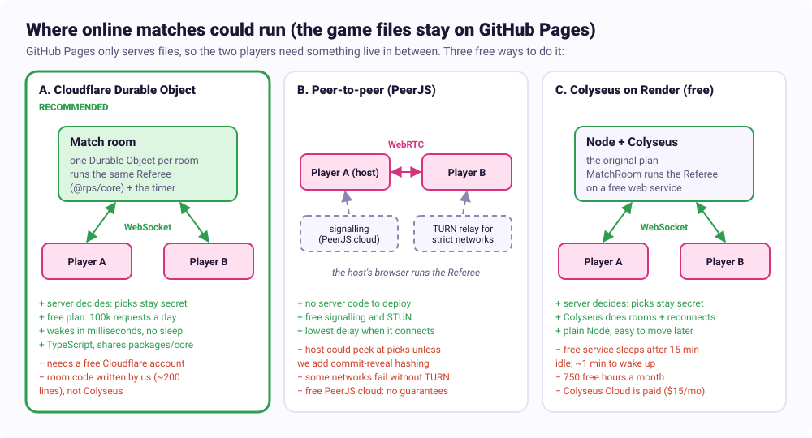

# Online play: where matches could run

_Written 2026-10-11 for step 5 of the roadmap. Free-tier numbers were checked on the providers' pages that day; free tiers change, so check again before building. The choice is the user's; nothing here is built yet._

The game itself stays on GitHub Pages. GitHub Pages only serves files, though: it can't keep two players connected, run the countdown or hide picks. So online play needs one more piece that is live while a match runs. This page compares free ways to provide it and recommends one. How the game code plugs into it is in [section 10 of the architecture doc](ARCHITECTURE.md#10-online-play).

## What the match host has to do

From the architecture (and the project's anti-cheat rule: only the server knows both picks before the reveal):

1. Pair two players by a short room code.
2. Run the countdown and the random fallback pick on one clock both players trust.
3. Keep each pick secret until both are in and time is up.
4. Send both players the same events (`phase`, `locked`, `reveal`, `matchOver`, rematch).
5. Cope with a player dropping out.

Our `Referee` in `packages/core` already does 2 to 4 if something runs it. The question is where it runs.

## The options

### A. Cloudflare Workers + Durable Objects (recommended)

A Durable Object is a tiny server-side object that Cloudflare starts on demand. One object per room code holds both players' WebSocket connections and runs our `Referee`, with a `Clock` that uses the object's timers.

- **Cost:** free on the Workers Free plan, which includes Durable Objects (SQLite-backed) with 100,000 requests a day and 13,000 GB-s of run time a day. A WebSocket connection counts as one request, incoming messages count 20 to 1, and outgoing messages are free. ([pricing](https://developers.cloudflare.com/durable-objects/platform/pricing), [limits](https://developers.cloudflare.com/durable-objects/platform/limits))
- **How far free goes:** run time is the tighter limit. A two-minute match keeps one object busy for about 120 s × 128 MB = 15 GB-s, so roughly 800 matches a day fit. Requests allow far more (a match is about 6). Going over makes new requests fail until midnight UTC; there is no surprise bill on the free plan.
- **Fits our design:** server-authoritative, exactly as the architecture planned. It runs TypeScript, and `@rps/core` has no dependencies, so the room imports the same rules and referee as the game.
- **No sleeping server:** objects start in milliseconds, so there's no "wait a minute while the server wakes up".
- **Downsides:** needs a free Cloudflare account and a deploy step (Wrangler, which can run from GitHub Actions). Colyseus doesn't run there, so we write the small room protocol ourselves (join, ready, pick, rematch, leave: roughly 200 lines). Cloudflare's [PartyServer and PartySocket](https://github.com/cloudflare/partykit) libraries make the WebSocket and reconnect parts easier.

### B. Peer-to-peer with WebRTC (PeerJS)

The two browsers connect directly. One player (the host) runs the `Referee`; the other sends picks to them.

- **Cost:** free. [PeerJS](https://peerjs.com/peerserver.html) offers a free public cloud server for the hand-shake (signalling); public STUN servers are free. Some connections (strict office or mobile networks) need a TURN relay: [Cloudflare's TURN](https://developers.cloudflare.com/realtime/sfu/platform/pricing/) has 1,000 GB a month free, and [Metered's Open Relay](https://metered.ca/tools/openrelay/) 20 GB a month, both with a free account.
- **Good:** no server code to deploy, and the lowest delay once connected.
- **Downsides:** the host's browser sees the guest's pick, which breaks the anti-cheat rule. It can be repaired with commit-reveal (each player first sends a hash of pick + random salt, then the pick once both hashes are in), but that changes the referee flow and the host still controls the clock. Some connections fail without TURN, and good TURN credentials need a small server anyway. The free PeerJS cloud makes no promises about uptime.

### C. Colyseus on a free web host (the original plan)

A Node server running [Colyseus](https://colyseus.io), with a `MatchRoom` wrapping the `Referee`.

- **Cost:** Colyseus is free to self-host; [Colyseus Cloud](https://www.colyseus.io/pricing) starts at $15 a month. The common free host is [Render](https://render.com/docs/free): 750 free hours a month, but a free service spins down after 15 minutes without traffic and takes about a minute to wake up.
- **Good:** Colyseus handles rooms, matchmaking and reconnects for us; plain Node is easy to move to a paid host later.
- **Downsides:** that one-minute wake-up hits the first player of every quiet period, which feels broken in a game. Free Node hosting keeps shrinking (Fly.io dropped its free allowance for new accounts, and Glitch stopped hosting projects in 2025). An always-free VM (for example Oracle Cloud) avoids the sleep but means running and patching a server.

### Also looked at

- **Firebase / Supabase realtime databases:** free tiers, but they sync data rather than run code, so hiding picks and owning the timer would need their server functions on top. More moving parts than A for the same result.
- **Photon and similar game relays:** free tiers (around 20 players at once), but the room logic runs in the clients unless you pay for server plugins, which has the same cheating problem as B.

## Comparison

| | A. Durable Objects | B. PeerJS P2P | C. Colyseus on Render |
|---|---|---|---|
| Monthly cost | Free (≈800 matches a day) | Free (TURN within free GB) | Free (750 h) |
| Picks hidden from the other player | Yes | Only with commit-reveal | Yes |
| Who owns the timer | Server | Host player | Server |
| Wait before the first match | None | None | ≈1 min after 15 min idle |
| Server code we write | Small room (~200 lines) | None (more client code) | Colyseus room |
| Reuses `@rps/core` unchanged | Yes | Yes (in the host) | Yes |
| Accounts needed | Cloudflare (free) | None, or a TURN account | Render (free) |

## Recommendation

**Option A, a Cloudflare Durable Object per room.** It keeps the architecture as designed (the server decides, picks stay secret, one shared rules package), costs nothing at hobby scale, and has no cold starts. The game stays on GitHub Pages and connects to the room over a WebSocket.

If accounts are a deal-breaker, option B works for casual play between friends, with commit-reveal added. Option C is the fallback if we later want Colyseus's features and are willing to pay for an always-on host.

What changes in the plan if A is chosen: "Node + Colyseus" in the project context becomes "Cloudflare Durable Object room". Everything else in the architecture stays: `apps/server` holds the room, `OnlineSession` talks to it, and the fight screens don't change.
